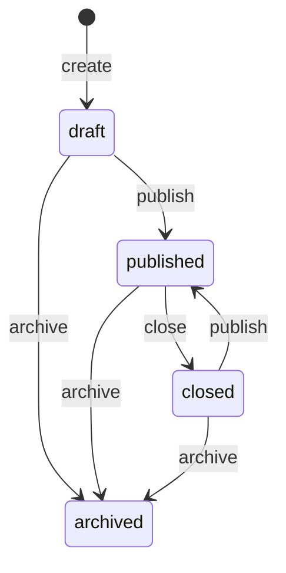

# Opportunities API (jobs and internships)

Job and internship listings published by GHAFRA. Members browse open listings
in the mobile app; admins create and manage them from the dashboard.

- Base path: `/opportunities`
- All endpoints require `Authorization: Bearer <supabase access token>`.
- Admin endpoints live under `/opportunities/admin` and also require the
  caller's profile to have `role = 'admin'`.

## Contents

- [Data model](#data-model)
- [Status and availability](#status-and-availability)
- [Mobile endpoints](#mobile-endpoints)
- [Dashboard (admin) endpoints](#dashboard-admin-endpoints)
- [Errors](#errors)
- [Push notification](#push-notification)

## Data model

| Field | Type | Notes |
|---|---|---|
| `id` | uuid | |
| `title` | string | 3 to 200 characters |
| `organization` | string | Company or organization name, 2 to 200 characters |
| `type` | `"job"` \| `"internship"` | |
| `description` | string | 20 to 10,000 characters |
| `qualifications` | string[] | Up to 30 items, default `[]` |
| `skills` | string[] | Up to 50 items, default `[]` |
| `location` | string | Free text, e.g. `"Lille, France"` or `"Remote"` |
| `application_deadline` | `"YYYY-MM-DD"` \| null | Last day to apply (inclusive, Paris time). `null` means no deadline |
| `application_method` | `"url"` \| `"email"` \| `"other"` | How to apply |
| `application_url` | string \| null | http(s) only. Required when method is `url` |
| `application_email` | string \| null | Required when method is `email` |
| `application_instructions` | string \| null | Required when method is `other` (e.g. "Drop your CV at the office") |
| `contact_name` | string \| null | Optional |
| `contact_email` | string \| null | Optional |
| `contact_phone` | string \| null | Optional |
| `image_url` | string \| null | Public image URL. `null` when the listing has no image |
| `status` | `"draft"` \| `"published"` \| `"closed"` \| `"archived"` | Read-only; changed via the action endpoints |
| `published_at` | ISO datetime \| null | Set on first publish and never changed afterwards |
| `closed_at` | ISO datetime \| null | Set when closed; cleared when re-published |
| `created_at`, `updated_at` | ISO datetime | |
| `availability` | see below | Computed on every response |
| `is_expired` | boolean | Computed: `true` when the deadline has passed |

Admin responses also include `created_by`, `updated_by`, `archived_at`, and
the embedded profiles `creator` and `updater` (`{ id, name, email }`).
Member responses don't include those fields.

## Status and availability



- New opportunities always start as `draft`.
- `archived` is final: archived listings can't be edited or re-published.
- Publishing is refused while `application_deadline` is in the past. Move the
  deadline (or clear it) first.

`availability` combines status and deadline so clients don't have to:

| `availability` | Meaning | Shown to members? |
|---|---|---|
| `open` | Published and the deadline hasn't passed | Yes |
| `expired` | Published, but the deadline has passed | No |
| `closed` | Closed by an admin | No |
| `draft` | Not published yet | No |
| `archived` | Archived | No |

An opportunity expires automatically at the end of its deadline day (Europe/Paris).
Nothing needs to run for this to happen: the status stays `published`, but members
stop seeing it, and admins see `availability: "expired"`. Admins can close it or
move the deadline.

## Response envelope

Single item:

```json
{ "success": true, "data": { "...": "..." } }
```

Lists:

```json
{
  "success": true,
  "data": [ { "...": "..." } ],
  "meta": { "total": 42, "page": 1, "limit": 20, "pages": 3 }
}
```

## Mobile endpoints

Any signed-in user. These endpoints only ever return listings whose
`availability` is `open`.

### `GET /opportunities`

Lists open opportunities, newest first (`published_at` descending).

| Query param | Type | Default | Notes |
|---|---|---|---|
| `page` | int ≥ 1 | 1 | |
| `limit` | int 1 to 50 | 20 | |
| `type` | `job` \| `internship` | | |
| `location` | string | | Case-insensitive "contains" match |
| `search` | string | | Matches title or organization |

```http
GET /opportunities?type=internship&location=lille&page=1&limit=20
Authorization: Bearer <token>
```

```json
{
  "success": true,
  "data": [
    {
      "id": "a3bb189e-8bf9-4888-9912-ace4e6543002",
      "title": "Data Analyst Intern",
      "organization": "Acme Lille",
      "type": "internship",
      "description": "Six-month internship supporting the analytics team.",
      "qualifications": ["Master student in statistics"],
      "skills": ["Excel", "Python"],
      "location": "Lille, France",
      "application_deadline": "2026-11-30",
      "application_method": "url",
      "application_url": "https://acme.example/jobs/42",
      "application_email": null,
      "application_instructions": null,
      "contact_name": null,
      "contact_email": null,
      "contact_phone": null,
      "image_url": "https://your-project.supabase.co/storage/v1/object/public/opportunity-images/a3bb189e-8bf9-4888-9912-ace4e6543002/cover.jpg",
      "status": "published",
      "published_at": "2026-10-24T09:00:00+00:00",
      "closed_at": null,
      "created_at": "2026-10-23T15:12:00+00:00",
      "updated_at": "2026-10-24T09:00:00+00:00",
      "availability": "open",
      "is_expired": false
    }
  ],
  "meta": { "total": 1, "page": 1, "limit": 20, "pages": 1 }
}
```

### `GET /opportunities/:id`

| Result | When |
|---|---|
| `200` with the opportunity | It is open |
| `404 NOT_FOUND` | It doesn't exist, is a draft, or is archived |
| `410 OPPORTUNITY_UNAVAILABLE` | It was published but is now closed or expired |

Use the 410 to show "This opportunity is no longer accepting applications",
for example when a member opens an old push notification.

## Dashboard (admin) endpoints

All require an admin. Every write is recorded in `admin_audit_log`.

### `GET /opportunities/admin`

Lists every opportunity regardless of status.

| Query param | Type | Default | Notes |
|---|---|---|---|
| `page`, `limit`, `type`, `location`, `search` | | | Same as the mobile list |
| `status` | `draft` \| `published` \| `closed` \| `archived` | | |
| `expired` | `true` \| `false` | | `true`: published and past the deadline. `false`: no deadline or deadline not passed |
| `sort_by` | `created_at` \| `updated_at` \| `published_at` \| `application_deadline` \| `title` | `created_at` | Empty values sort last |
| `sort_order` | `asc` \| `desc` | `desc` | |

### `GET /opportunities/admin/:id`

Returns one opportunity in any status, with `creator` and `updater`.

### `POST /opportunities/admin`

Creates a **draft**. Returns `201`.

```http
POST /opportunities/admin
Authorization: Bearer <admin token>
Content-Type: application/json

{
  "title": "Junior Backend Developer",
  "organization": "Acme Lille",
  "type": "job",
  "description": "Build and maintain APIs for our logistics platform.",
  "qualifications": ["Bachelor in Computer Science"],
  "skills": ["TypeScript", "PostgreSQL"],
  "location": "Lille, France",
  "application_deadline": "2026-11-30",
  "application_method": "email",
  "application_email": "jobs@acme.example",
  "contact_name": "Ama Mensah",
  "contact_phone": "+33 6 12 34 56 78"
}
```

Required: `title`, `organization`, `type`, `description`, `location`,
`application_method`, and the detail field that matches the method.
Unknown fields (including `status`) are rejected with `422`.

`image_url` is optional. Two ways to set it, and only one at a time:

**Pasted URL** (JSON, same request as above). Add `"image_url": "https://cdn.example/cover.jpg"`.
The URL must be `http` or `https`. It is saved as-is and is not downloaded.

**File upload** (`multipart/form-data`, not JSON):

| Part | Type | Contents |
|---|---|---|
| `data` | text | The same JSON object as the JSON request, without `image_url` |
| `image` | file | One JPEG, PNG, or WebP, 5 MB or smaller |

The file is stored in the public Supabase bucket `opportunity-images`. The response
`image_url` is the public URL. The mobile app and the dashboard can load it
with no token.

Sending a file and `image_url` together returns `422`.

### `PATCH /opportunities/admin/:id`

Updates any subset of the fields accepted by create. Works on `draft`,
`published` and `closed` listings; archived ones return `409`.

- Send `null` to clear an optional field, including `"image_url": null`.
- To replace the image, send a new file (multipart, `data` plus `image`) or a new `image_url`. The previous uploaded file is deleted. A pasted external URL is not deleted, because it is not in our storage.
- A file on its own is enough: `data` may be `{}`.
- If you change `application_method`, send its matching detail field too,
  unless it's already set.
- Editing a published listing takes effect immediately for members.

### `POST /opportunities/admin/:id/publish`

`draft` or `closed` → `published`. The first publish sets `published_at` and
sends a push notification to members. Re-publishing a closed listing doesn't
send another one.

### `POST /opportunities/admin/:id/close`

`published` → `closed`. Members stop seeing it straight away.

### `POST /opportunities/admin/:id/archive`

`draft`, `published` or `closed` → `archived`. Final.

All three return `200` with the updated opportunity. They take no body.

## Errors

```json
{
  "success": false,
  "error": {
    "message": "Validation failed",
    "code": "VALIDATION_ERROR",
    "issues": [{ "field": "application_url", "message": "application_url is required when application_method is \"url\"" }]
  }
}
```

`issues` is only present for request validation errors.

| Status | `code` | When |
|---|---|---|
| 401 | `UNAUTHORIZED` | Missing or invalid token |
| 403 | `FORBIDDEN` | Not an admin (admin endpoints) |
| 404 | `NOT_FOUND` | Unknown id, or hidden from members |
| 409 | `INVALID_STATUS_TRANSITION` | e.g. closing a draft, publishing an archived listing |
| 409 | `OPPORTUNITY_ARCHIVED` | Editing an archived listing |
| 409 | `CONFLICT` | Another admin changed the listing at the same time. Reload and retry |
| 410 | `OPPORTUNITY_UNAVAILABLE` | Member opened a closed or expired listing |
| 422 | `VALIDATION_ERROR` | Invalid body, query or id, or a file and `image_url` together |
| 422 | `DEADLINE_PASSED` | Publishing with a past deadline |
| 422 | `IMAGE_TOO_LARGE` | Image over 5 MB |
| 422 | `UNSUPPORTED_IMAGE` | Not a JPEG, PNG, or WebP (the file contents are checked, not just the filename) |

## Push notification

Sent to every registered device when an opportunity is published for the
first time.

```json
{
  "notification": {
    "title": "💼 New job opportunity",
    "body": "Junior Backend Developer at Acme Lille"
  },
  "data": {
    "type": "opportunity",
    "opportunity_id": "a3bb189e-8bf9-4888-9912-ace4e6543002"
  }
}
```

Internships use the title `🎓 New internship opportunity`. Use
`data.opportunity_id` to open the detail screen via `GET /opportunities/:id`,
and handle the `410` in case it has closed since.
